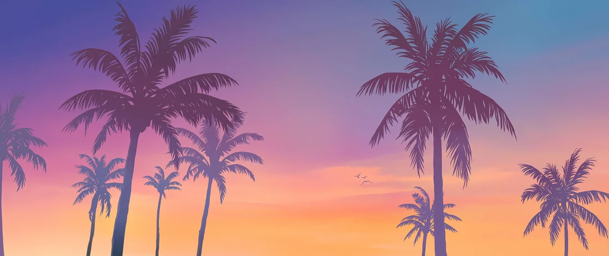
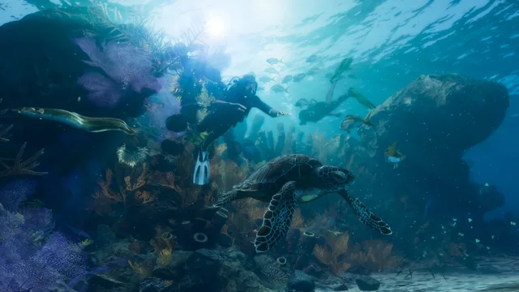
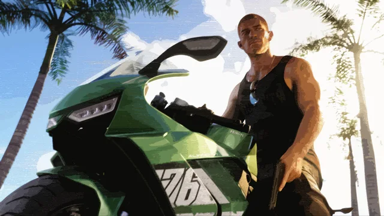

# GTA VI Theme for Omarchy

An unofficial fan theme with 16 wallpaper-matched palettes and 27 backgrounds.

[](backgrounds/1-vice-sunset-ultrawide.webp)

## Install

```bash
omarchy theme install https://github.com/debpalash/omarchy-gta6-theme.git
```

## Editions

| Leonida Blue · Dark | Coastal Rider · Light |
| :---: | :---: |
| [](backgrounds/15-leonida-blue.jpg) | [](backgrounds/18-coastal-rider.jpg) |

Vice Sunset is the default. [Browse and switch editions](variants/README.md).

[Artwork credits](ASSETS.md) · [MIT license for code and docs](LICENSE)
